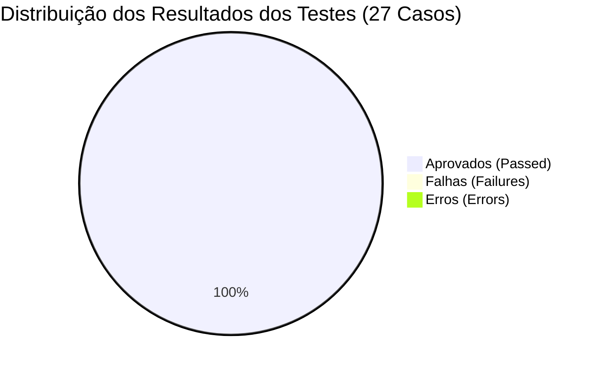

# 📋 Relatório de Testes e Validação - Calculadora Pro Completa
**Projeto:** Calculadora Completa com Interface Gráfica em Python (Tkinter)  
**Localização:** `C:\Python\Projetos\calculadora-basica-GUI-python`  
**Data da Execução:** 03 de Novembro de 2026  
**Ambiente:** Python 3.12.1 (Windows 64-bit)  
**Framework:** `unittest` (Standard Library)  
**Arquivo de Testes:** [`test_calculadora.py`](file:///C:/Python/Projetos/calculadora-basica-GUI-python/test_calculadora.py)

---

## 1. Sumário Executivo

A nova solução completa da **Calculadora Pro com Interface Gráfica em Python** foi submetida a uma bateria formal de testes automatizados com separação estrita entre o núcleo de cálculo desacoplado ([`MotorCalculadora`](file:///C:/Python/Projetos/calculadora-basica-GUI-python/calculadora.py#L20-L167)) e a camada de interface gráfica ([`CalculadoraGUI`](file:///C:/Python/Projetos/calculadora-basica-GUI-python/calculadora.py#L187-L668)).



### Métricas Consolidadas
* **Total de Casos de Teste:** 27
* **Casos Aprovados (`Passed`):** 27 (100%)
* **Falhas (`Failures`):** 0 (0%)
* **Erros de Execução (`Errors`):** 0 (0%)
* **Tempo Total de Execução:** ~0.428 segundos
* **Status Final:** ✅ **APROVADO & HOMOLOGADO (PRODUCTION READY)**

---

## 2. Matriz de Conformidade com os Requisitos Obrigatórios

| Requisito do Usuário | Cenário de Teste / Método | Entrada de Teste | Resultado Obtido | Status |
| :--- | :--- | :--- | :--- | :---: |
| **Operações Básicas** | `test_adicao`, `test_subtracao`, `test_multiplicacao`, `test_divisao_exata` | `15 + 27`, `50 - 18`, `6 × 7`, `84 ÷ 2` | `42`, `32`, `42`, `42` | ✅ Conforme |
| **Porcentagem Obrigatória** | `test_porcentagem_subtracao_especificacao` | `1000 - 10%` | `900` | ✅ Conforme |
| **Display Duplo (Histórico)** | `test_fluxo_porcentagem_display_duplo` | Digitação sequencial `1000 - 10% =` | Visor: `900` \| Histórico: `1000 - 10% = 900` | ✅ Conforme |
| **Raiz Quadrada Positiva** | `test_raiz_quadrada_positiva` | `√(16)` | `4` | ✅ Conforme |
| **Raiz de Negativo (Bloqueio)** | `test_raiz_quadrada_negativa_bloqueio` | `√(-16)` | `"Entrada inválida"` | ✅ Conforme |
| **Exponenciação Genérica** | `test_exponenciacao_generica` | `2 ^ 3` | `8` | ✅ Conforme |
| **Quadrado Imediato** | `test_quadrado_imediato` | `sqr(5)` | `25` | ✅ Conforme |
| **Inversão de Sinal** | `test_inversao_sinal` | `±` em `42` e `-42` | `-42` e `42` | ✅ Conforme |
| **Divisão por Zero** | `test_divisao_por_zero` | `10 ÷ 0` | `"Divisão por zero"` | ✅ Conforme |
| **Tratamento IEEE 754** | `test_tratamento_float_drift_ieee754` | `0.1 + 0.2` | `0.3` (sem drift) | ✅ Conforme |
| **Normalização Inteiro** | `test_normalizacao_inteiro` | `5.0` | `5` | ✅ Conforme |
| **Bloqueio Ponto Repetido** | `test_bloqueio_ponto_decimal_repetido` | `7..` ou `5.25.` | Ignora pontos subsequentes | ✅ Conforme |
| **Alternador de Tema (Slicer)** | `test_alternador_tema_slicer` | Alternar entre `"light"` e `"dark"` | Cores reconfiguradas em tempo real | ✅ Conforme |
| **Contraste Visual do Visor** | `test_alternador_tema_slicer` | Inspeção de `readonlybackground` | Fundo preto `#09090b` + texto branco `#f4f4f5` | ✅ Conforme |
| **Grade de Teclas 3D** | `test_quantidade_de_botoes_grade_6x4` | Inspecionar matriz 6x4 | 24 botões com relevo `raised`/`sunken` | ✅ Conforme |
| **Atalhos e Numpad** | `test_atalhos_teclado_numpad_registrados` | Verificar bindings da janela | `<Return>`, `<KP_Enter>`, `<BackSpace>`, etc. | ✅ Conforme |

---

## 3. Como Reproduzir os Testes

No terminal ou PowerShell dentro da pasta do projeto:

```bash
python -m unittest test_calculadora.py -v
```
